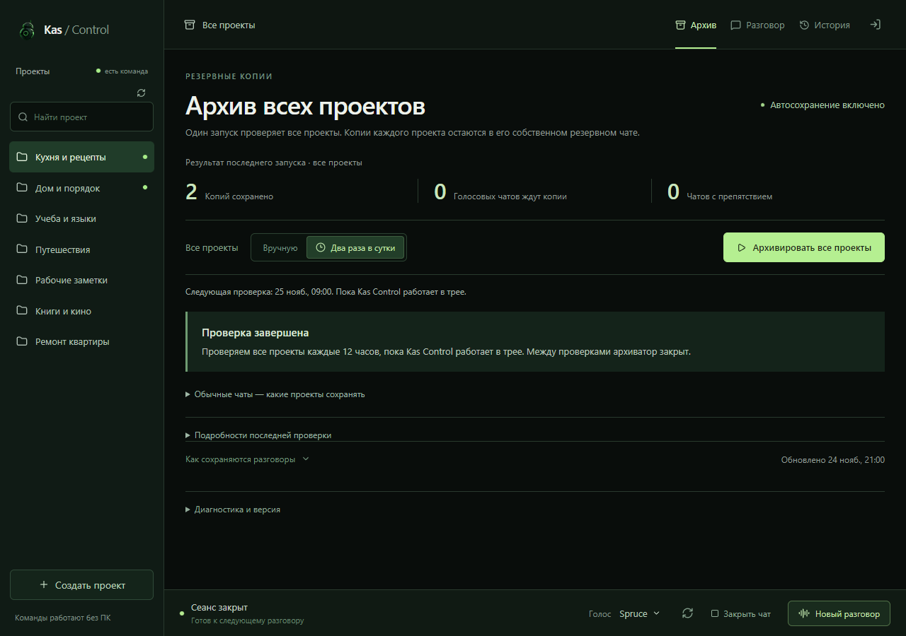

# Kas Control

**Кас Пульт превращает Яндекс Станцию в голосовой вход в ваши проекты ChatGPT.** Команда «Алиса, готовка» открывает новый разговор в проекте с рецептами. Следом можно спросить, какую программу выбрать на аэрогриле, и уточнять шаги, пока руки заняты. По другой команде та же колонка открывает проект с конспектами или рабочей повесткой.

**[Скачать 4.0 для Windows x64](https://github.com/Startupingarage/kas-control/releases/tag/v4.0)** · [Первый запуск](docs/GETTING_STARTED.md) · [Подготовка колонки](docs/PREREQUISITES.md)


## Как мы пришли к пульту

1. **Подготовили свою Станцию Лайт 2 (Plum).** Для этой модели использовали описанный сообществом путь получения root на основе заводского сертификата из раздела `factory`. После подготовки проверили рабочий административный вход по SSH. Справочник по моделям и восстановлению ведут Marker284 и участники сообщества. [Yandex Station Extended / HackAlice](https://hackalice.me/) · [Репозиторий Marker284](https://github.com/Marker284/yandex-station-extended).
2. **Подключили ChatGPT Voice.** В качестве основы взяли нативный клиент Alisa Voice от rison1337. Он ведет голосовой разговор с микрофона и динамика колонки. Сначала проверили обычный разговор и его завершение. [Alisa Voice](https://github.com/rison1337/Alisa-ChatGPT-voice-assistant).
3. **Связали фразы с проектами.** Наш маршрутизатор получает распознанную фразу, находит проект и выбирает свободный голосовой чат. Расширение клиента пополняет запас в простое после закрытия сеанса. Фраза и маршрутизация хранятся на колонке, поэтому после настройки говорить можно с выключенным ПК. [Маршрутизатор](router/README.md) · [Расширение нативного клиента](native/README.md).
4. **Собрали Windows-пульт.** В нем назначаются команды, выбирается голос, открывается история и запускается архивация. Завершенные голосовые разговоры копируются в отдельный резерв соответствующего проекта. [Как работает архив](docs/VOICE_ARCHIVE.md).

Команда выбирает **проект**, потому что его инструкции и файлы нужны при каждом запуске. Сам разговор каждый раз начинается в отдельном чате. Например, один проект хранит руководство для аэрогриля и рецепты, другой — темы курса, третий — материалы к рабочей встрече. [Три разобранных сценария](docs/USE_CASES.md).

Идеи для сегментной мимики изучали по Pulsar. Документацию по интеграции с устройством сверяли с материалами сообщества. [Авторы и смежные проекты](docs/PREREQUISITES.md#внешние-проекты).

## Маршрут установки

| Этап | Что должно работать к концу |
| --- | --- |
| [Подготовка своей Станции](docs/PREREQUISITES.md) | Вход по SSH, сохраненная конфигурация и доступный откат |
| [Нативный Alisa Voice](docs/PREREQUISITES.md#2-запустите-нативный-голосовой-клиент) | Колонка отвечает голосом и закрывает сеанс по команде |
| [Маршрутизатор и режим проектов](router/README.md#install-on-a-prepared-station) | Маршрутизатор подключен, клиент поддерживает `prepare_chats_v1` |
| [Пульт на Windows](docs/GETTING_STARTED.md) | Пульт видит колонку и проекты аккаунта ChatGPT |
| [Разговор и резервная копия](docs/GETTING_STARTED.md#4-назначьте-фразу-и-проверьте-два-запуска) | Два вызова открывают разные чаты, реплики закрытого сеанса доступны в резерве проекта |

## Первый разговор

1. Проверьте, что голосовой клиент уже отвечает на колонке и доступен по SSH. Для настройки с нуля начните с [подготовки Станции и проверки совместимости](docs/PREREQUISITES.md).
2. Скачайте `Kas-Control-4.0.zip` из Releases и распакуйте его в постоянную папку. Оставьте `KasControl.exe` и `KasArchiveWorker.exe` рядом.
3. Настройте подключение `station`, запустите `KasControl.exe` и войдите в тот же аккаунт ChatGPT, который использует колонка. [Пошаговая настройка Windows](docs/GETTING_STARTED.md).
4. Выберите проект слева. В разделе **Разговор** введите `готовка` в поле **Команда колонки** и нажмите **Сохранить**. Зеленая точка рядом с проектом подтверждает, что команда назначена.
5. Скажите **«Алиса, готовка»** и задайте вопрос. Для завершения скажите **«Алиса, закрой чат»**. Следующий вызов откроет новый чат в том же проекте.

> **Пример.** Загрузите в проект «Кухня и рецепты» руководство к аэрогрилю и рецепты. В инструкциях проекта попросите опираться на вашу модель и объяснять, какие кнопки нажать. Через колонку можно спросить «Как приготовить куриные бедра?» и уточнять шаги, пока руки заняты. [Сценарии для готовки, учебы и работы](docs/USE_CASES.md).

## Что входит в 4.0

- **Команды проектов.** Новый разговор открывается в том проекте, которому назначена фраза. Команда «Алиса, открой чат» открывает новый разговор в последнем проекте. При наличии горячего пополнения колонка держит до восьми заготовок на проект и восполняет запас после закрытия сеанса.
- **Отдельная история проекта.** Из раздела **История** можно открыть разговор в ChatGPT. Голосовые команды и подготовка следующих чатов работают на колонке при выключенном ПК.
- **Архив всех проектов.** Один запуск проверяет завершенные голосовые разговоры. Для обычных чатов можно включить копирование новых сообщений и правок отдельно в каждом проекте. Целевой резервный чат всегда находится в проекте исходника.
- **Легкий трей.** Закрытие окна освобождает WebView2. Архиватор запускается вручную или каждые 12 часов, пока пульт работает в трее, и завершает работу после проверки. Пункт **Выйти** в трее останавливает таймер и текущий архиватор.

## Первая архивация

1. Завершите голосовой разговор и откройте **Архив → Архивировать все проекты**.
2. Дождитесь результата. При активном разговоре архиватор ждет, при ограничении частоты запросов выдерживает паузу. Причины и результаты доступны в **Подробностях последней проверки**.
3. Откройте **Резервный голосовой чат** внутри своего проекта в ChatGPT. Там сохраняется текст реплик. Исходный голосовой чат удаляется после проверки копии и повторной проверки исходника. Оригиналы обычных чатов сохраняются.



[Правила копирования, вложения и восстановление после паузы](docs/VOICE_ARCHIVE.md).

## Совместимость

Контрольная конфигурация проекта — Яндекс Станция Лайт 2 (Plum), нативный голосовой клиент Linux ARM64 и Windows x64 с OpenSSH Client и [Microsoft Edge WebView2 Runtime](https://developer.microsoft.com/en-us/microsoft-edge/webview2/). Для команд проектов требуется режим `project_sessions` в маршрутизаторе. Горячее пополнение требует `prepare_chats_v1` у нативного клиента.

Пульт устанавливается поверх рабочего голосового контура. Подготовка устройства и голосового клиента описана отдельно. [Условия, Alisa Voice, HackAlice и другие проекты](docs/PREREQUISITES.md).

Интеграция использует веб-сессию ChatGPT и неофициальные веб-интерфейсы. Изменения на стороне ChatGPT могут потребовать повторного входа или обновления версии. Возможность использовать контекст других чатов определяется настройками памяти ChatGPT. [Как работают проекты и память](https://help.openai.com/en/articles/10169521-using-projects-in-chatgpt).

## Сборка из исходников

Для сборки под Windows нужны Python 3.12 x64, Node.js 24 и pnpm 11. Команды выполняются из корня репозитория.

```powershell
python -m venv .venv
.\.venv\Scripts\python.exe -m pip install -r requirements-build.txt
pnpm.cmd --dir frontend install --frozen-lockfile
.\build-modern.ps1
```

Результат сборки — `dist\KasControlModern.exe` и `dist\KasArchiveWorker.exe`. В комплекте Releases интерфейс называется `KasControl.exe`. Для демонстрации интерфейса запустите `pnpm.cmd --dir frontend dev` и добавьте `?demo=1` к локальному адресу из вывода.

Код маршрутизатора и команды его тестирования находятся в [router/](router/README.md). Проверки Python и Playwright изолированы от реальных разговоров. Проверку голосовой связи с устройством проводите отдельно после установки.

## Лицензия

Copyright © 2026 Startupingarage. Все права защищены. [Условия использования оригинальных частей проекта](LICENSE). Сторонние компоненты сохраняют собственные лицензии.
