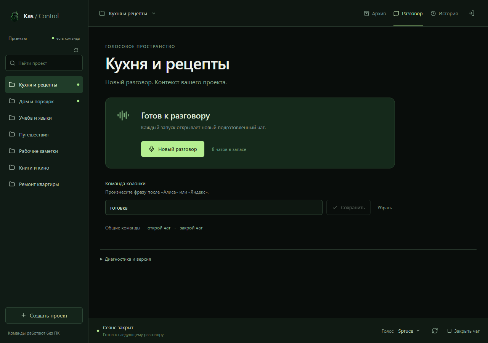
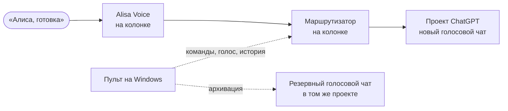

<div align="center">

# Kas Control

### Кас Пульт · голосовой вход в ваши проекты ChatGPT через Яндекс Станцию

[](https://github.com/Startupingarage/kas-control/releases/tag/v4.0)


[](LICENSE)

<br>

[](https://github.com/Startupingarage/kas-control/releases/tag/v4.0)
[](docs/GETTING_STARTED.md)
[](docs/PREREQUISITES.md)

**[Скачать готовый ARMhf-клиент](https://github.com/Startupingarage/kas-control/releases/download/v4.0/Kas-Alisa-Voice-0.3.10-armhf.tar.gz)** · [SHA-256 ARMhf-клиента](https://github.com/Startupingarage/kas-control/releases/download/v4.0/Kas-Alisa-Voice-0.3.10-armhf.tar.gz.sha256)

<br>

[Зачем](#зачем) · [Что входит в 4.0](#что-входит-в-40) · [Установка](#маршрут-установки) · [Первый разговор](#первый-разговор) · [Архивация](#первая-архивация) · [Как устроено](#как-мы-пришли-к-пульту) · [Совместимость](#совместимость) · [Сборка](#сборка-из-исходников) · [Лицензия](#лицензия)

<br>



<sub>Раздел разговора с командой «готовка» и запасом чатов. Данные вымышлены.</sub>

</div>

<br>

## Зачем

**Кас Пульт превращает Яндекс Станцию в голосовой вход в ваши проекты ChatGPT.** Команда «Алиса, готовка» открывает новый разговор в проекте с рецептами. Следом можно спросить, какую программу выбрать на аэрогриле, и уточнять шаги, пока руки заняты. По другой команде та же колонка открывает проект с конспектами или рабочей повесткой.

Команда выбирает **проект**, потому что его инструкции и файлы нужны при каждом запуске. Сам разговор каждый раз начинается в отдельном чате. Например, один проект хранит руководство для аэрогриля и рецепты, другой — темы курса, третий — материалы к рабочей встрече.

> [!TIP]
> **Пример.** Загрузите в проект «Кухня и рецепты» руководство к аэрогрилю и рецепты. В инструкциях проекта попросите опираться на вашу модель и объяснять, какие кнопки нажать. Через колонку можно спросить «Как приготовить куриные бедра?» и уточнять шаги, пока руки заняты.
>
> 📚 [Три разобранных сценария: готовка, учеба и работа](docs/USE_CASES.md)

## Что входит в 4.0

<table>
<tr>
<td width="50%" valign="top">

### 🎙️ Команды проектов

Новый разговор открывается в том проекте, которому назначена фраза. Команда «Алиса, открой чат» открывает новый разговор в последнем проекте. При наличии горячего пополнения колонка держит **до восьми заготовок** на проект и восполняет запас после закрытия сеанса.

</td>
<td width="50%" valign="top">

### 🗂️ Отдельная история проекта

Из раздела **История** можно открыть разговор в ChatGPT. Голосовые команды и подготовка следующих чатов работают на колонке **при выключенном ПК**.

</td>
</tr>
<tr>
<td width="50%" valign="top">

### 📦 Архив всех проектов

Один запуск проверяет завершенные голосовые разговоры. Для обычных чатов можно включить копирование новых сообщений и правок отдельно в каждом проекте. Целевой резервный чат всегда находится **в проекте исходника**.

</td>
<td width="50%" valign="top">

### 🪶 Легкий трей

Закрытие окна освобождает WebView2. Архиватор запускается вручную или **каждые 12 часов**, пока пульт работает в трее, и завершает работу после проверки. Пункт **Выйти** в трее останавливает таймер и текущий архиватор.

</td>
</tr>
</table>

## Маршрут установки

**Основной вариант — установка без сборки.** Возьмите официальный Linux-пакет Alisa Voice 0.3.10, распакуйте поверх него готовый ARMhf-клиент из релиза Кас Пульта и запустите штатный установщик. Затем установите маршрутизатор и Windows-пульт.

| # | Этап | Что должно работать к концу |
| :-: | --- | --- |
| 1 | [Подготовка своей Станции](docs/PREREQUISITES.md) | Вход по SSH, сохраненная конфигурация и доступный откат |
| 2 | [Установка готового ARMhf-клиента](docs/ALISA_VOICE_0310.md) | Колонка отвечает голосом, закрывает сеанс и сообщает `prepare_chats_v1` |
| 3 | [Маршрутизатор и режим проектов](router/README.md#install-on-a-prepared-station) | Маршрутизатор подключен, клиент поддерживает `prepare_chats_v1` |
| 4 | [Пульт на Windows](docs/GETTING_STARTED.md) | Пульт видит колонку и проекты аккаунта ChatGPT |
| 5 | [Разговор и резервная копия](docs/GETTING_STARTED.md#4-назначьте-фразу-и-проверьте-два-запуска) | Два вызова открывают разные чаты, реплики закрытого сеанса доступны в резерве проекта |

## Первый разговор

1. **Проверьте колонку.** Голосовой клиент уже отвечает на колонке и доступен по SSH. Для настройки с нуля начните с [подготовки Станции и проверки совместимости](docs/PREREQUISITES.md).
2. **Скачайте пульт.** Скачайте `Kas-Control-4.0.zip` из Releases и распакуйте его в постоянную папку. Оставьте `KasControl.exe` и `KasArchiveWorker.exe` рядом.
3. **Подключитесь.** Настройте подключение `station`, запустите `KasControl.exe` и войдите в тот же аккаунт ChatGPT, который использует колонка. [Пошаговая настройка Windows](docs/GETTING_STARTED.md).
4. **Назначьте фразу.** Выберите проект слева. В разделе **Разговор** проверьте фразу `готовка`. Если команда еще не задана, введите ее в поле **Команда колонки** и нажмите **Сохранить**. Зеленая точка рядом с проектом подтверждает привязку.
5. **Поговорите.** Скажите **«Алиса, готовка»** и задайте вопрос. Для завершения скажите **«Алиса, закрой чат»**. Следующий вызов откроет новый чат в том же проекте.

## Первая архивация

1. Завершите голосовой разговор и откройте **Архив → Архивировать все проекты**.
2. Дождитесь результата. При активном разговоре архиватор ждет, при ограничении частоты запросов выдерживает паузу. Причины и результаты доступны в **Подробностях последней проверки**.
3. Откройте **Резервный голосовой чат** внутри своего проекта в ChatGPT. Там сохраняется текст реплик.

> [!IMPORTANT]
> Исходный голосовой чат удаляется после проверки копии и повторной проверки исходника. Оригиналы обычных чатов сохраняются.

<div align="center">


<sub>Общий архив проектов. Данные вымышлены.</sub>
</div>

<br>

📖 [Правила копирования, вложения и восстановление после паузы](docs/VOICE_ARCHIVE.md)

## Как мы пришли к пульту



1. **Подготовили свою Станцию Лайт 2 (Plum).** Для этой модели использовали описанный сообществом путь получения root на основе заводского сертификата из раздела `factory`. После подготовки проверили рабочий административный вход по SSH. Справочник по моделям и восстановлению ведут Marker284 и участники сообщества.<br>
   🔗 [Yandex Station Extended / HackAlice](https://hackalice.me/) · [Репозиторий Marker284](https://github.com/Marker284/yandex-station-extended)
2. **Подключили ChatGPT Voice.** В качестве основы взяли нативный клиент Alisa Voice от rison1337. Он ведет голосовой разговор с микрофона и динамика колонки. Сначала проверили обычный разговор и его завершение.<br>
   🔗 [Alisa Voice](https://github.com/rison1337/Alisa-ChatGPT-voice-assistant)
3. **Связали фразы с проектами.** Наш маршрутизатор получает распознанную фразу, находит проект и выбирает свободный голосовой чат. Расширение клиента пополняет запас в простое после закрытия сеанса. Фраза и маршрутизация хранятся на колонке, поэтому после настройки говорить можно с выключенным ПК.<br>
   🔗 [Маршрутизатор](router/README.md) · [Расширение нативного клиента](native/README.md)
4. **Собрали Windows-пульт.** В нем назначаются команды, выбирается голос, открывается история и запускается архивация. Завершенные голосовые разговоры копируются в отдельный резерв соответствующего проекта.<br>
   🔗 [Как работает архив](docs/VOICE_ARCHIVE.md)

Идеи для сегментной мимики изучали по Pulsar. Документацию по интеграции с устройством сверяли с материалами сообщества. [Авторы и смежные проекты](docs/PREREQUISITES.md#внешние-проекты).

## Совместимость

Конфигурация руководства:

- 🔊 **Колонка** — Станция Лайт 2 (Plum) с ядром AArch64
- 🎙️ **Голосовой клиент** — нативный клиент ARMhf
- 🧭 **Маршрутизатор** — Linux ARM64
- 🖥️ **ПК** — Windows x64 с OpenSSH Client и [Microsoft Edge WebView2 Runtime](https://developer.microsoft.com/en-us/microsoft-edge/webview2/)

Для команд проектов требуется режим `project_sessions` в маршрутизаторе. Горячее пополнение требует `prepare_chats_v1` у нативного клиента.

Пульт устанавливается поверх рабочего голосового контура. Подготовка устройства и голосового клиента описана отдельно. [Условия, Alisa Voice, HackAlice и другие проекты](docs/PREREQUISITES.md).

> [!WARNING]
> Интеграция использует веб-сессию ChatGPT и неофициальные веб-интерфейсы. Изменения на стороне ChatGPT могут потребовать повторного входа или обновления версии. Возможность использовать контекст других чатов определяется настройками памяти ChatGPT. [Как работают проекты и память](https://help.openai.com/en/articles/10169521-using-projects-in-chatgpt).

## Сборка из исходников

Сборка клиента для колонки описана отдельно. [Исходники ARMhf-клиента](docs/ALISA_VOICE_0310.md#сборка-из-исходников).

Для сборки под Windows нужны **Python 3.12 x64**, **Node.js 24** и **pnpm 11**. Команды выполняются из корня репозитория.

```powershell
python -m venv .venv
.\.venv\Scripts\python.exe -m pip install -r requirements-build.txt
pnpm.cmd --dir frontend install --frozen-lockfile
.\build-modern.ps1
```

Результат сборки — `dist\KasControlModern.exe` и `dist\KasArchiveWorker.exe`. В комплекте Releases интерфейс называется `KasControl.exe`.

> [!TIP]
> Для демонстрации интерфейса запустите `pnpm.cmd --dir frontend dev` и добавьте `?demo=1` к локальному адресу из вывода.

Код маршрутизатора и команды его тестирования находятся в [router/](router/README.md). Проверки Python и Playwright изолированы от реальных разговоров. Проверку голосовой связи с устройством проводите отдельно после установки.

## Лицензия

Copyright © 2026 Startupingarage. Все права защищены. [Условия использования оригинальных частей проекта](LICENSE). Сторонние компоненты сохраняют собственные лицензии.
