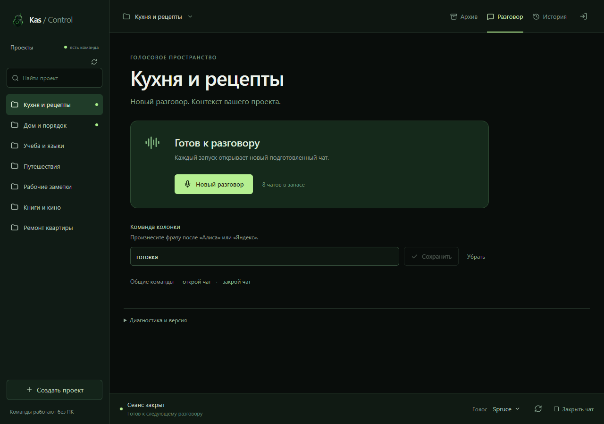

# Установка и первый разговор

Ниже показан запуск Kas Control 4.0 в режиме команд проектов. В примерах используются вымышленные названия и данные.

## 1. Проверьте колонку

- Голосовой клиент уже отвечает в ChatGPT и завершает сеанс штатной командой.
- Работает SSH-вход на вашу колонку.
- Маршрутизатор версии 4.0 запущен с `project_sessions: true` и первой командой тестового проекта. Если нужных компонентов еще нет, сначала пройдите [подготовку колонки](PREREQUISITES.md) и [установку маршрутизатора](../router/README.md#install-on-a-prepared-station).

## 2. Подготовьте Windows

1. Скачайте `Kas-Control-4.0.zip` из [Assets релиза 4.0](https://github.com/Startupingarage/kas-control/releases/tag/v4.0). Для приватного репозитория потребуется войти в GitHub с доступом к нему.
2. Распакуйте комплект, например в `C:\Apps\KasControl`. В этой папке должны лежать оба файла — `KasControl.exe` и `KasArchiveWorker.exe`.
3. Убедитесь, что в Windows есть OpenSSH Client и WebView2 Runtime. [Установка OpenSSH Client](https://learn.microsoft.com/en-us/windows-server/administration/openssh/openssh_install_firstuse) · [Установщик Microsoft WebView2 Evergreen](https://developer.microsoft.com/en-us/microsoft-edge/webview2/).

Создайте файл `%LOCALAPPDATA%\KasControl\SSH\config` без расширения. Подставьте адрес, порт, пользователя и путь к ключу вашей уже настроенной колонки. Адрес в примере служит заглушкой.

```sshconfig
Host station
    HostName 192.0.2.10
    Port 2222
    User root
    IdentityFile ~/.ssh/kas_station_ed25519
    IdentitiesOnly yes
```

При первом входе сверяйте отпечаток с данными своего устройства. Затем проверьте, что профиль отрабатывает без запроса пароля и подтверждения.

```powershell
$stationConfig = Join-Path $env:LOCALAPPDATA 'KasControl\SSH\config'
ssh.exe -T -F $stationConfig -o BatchMode=yes station true
$LASTEXITCODE
```

Результат — `0`. Если код другой, сначала проверьте адрес и порт, имя узла `station` и доступ к ключу. Пульт использует этот же профиль.

### Обновление с предыдущей сборки

Завершите старый пульт через **Выйти** в системном трее, распакуйте новую версию в отдельную папку и запустите ее `KasControl.exe`. Обновите ярлык, если он ссылается на старый путь. Папка `%LOCALAPPDATA%\KasControl` хранит ваш профиль и настройки и используется новой сборкой.

## 3. Подключите аккаунт

1. Запустите `KasControl.exe`.
2. Нажмите **Войти в ChatGPT** в правом верхнем углу и завершите вход в веб-окне. Используйте тот же аккаунт, который настроен на колонке.
3. Обновите список проектов слева. Для первого запуска удобно взять отдельный тестовый проект. Инструкции и файлы для него можно добавить в самом ChatGPT.

При первом запуске пульт добавляет себя в автозапуск Windows. Закрытие окна оставляет управление в трее. Для полного завершения откройте меню значка в трее и нажмите **Выйти**.

## 4. Назначьте фразу и проверьте два запуска

1. Откройте нужный проект и перейдите в **Разговор**. Для проекта из примера установки фраза `готовка` уже задана. Для другого проекта введите и сохраните свою фразу. Слово «Алиса» произносится при вызове, в поле вводится только сама команда.
2. Скажите **«Алиса, готовка»** или нажмите **Новый разговор**. Дождитесь ответа Каса на вопрос.
3. Скажите **«Алиса, закрой чат»**. Дождитесь статуса **Сеанс закрыт** и повторите вызов. В **Истории** появится отдельный разговор после сохранения реплик в ChatGPT.



## 5. Проверьте архив

Закройте тестовый разговор и нажмите **Архив → Архивировать все проекты**. После завершения откройте в ChatGPT **Резервный голосовой чат** этого проекта и найдите свои тестовые реплики. Пульт удаляет исходник управляемого голосового сеанса после проверки резервного текста. Обычные чаты архивируются только для выбранных проектов и сохраняются в истории.

В разделе **Архив** можно выбрать **Вручную** или **Два раза в сутки**. При автоматическом режиме проверка запускается через легкий процесс в трее. [Подробности архивации](VOICE_ARCHIVE.md).

## Если что-то не получается

- **Станция недоступна.** Повторите проверку SSH выше и обновите состояние стрелкой внизу пульта.
- **ChatGPT не отдает проекты.** Повторите вход из пульта и обновите список слева. Уже сохраненные голосовые фразы остаются доступны на колонке.
- **Открывается интерфейс отдельных чатов.** Проверьте `project_sessions` в конфигурации маршрутизатора. Инструкция выше относится к режиму команд проектов.
- **Запас остается нулевым.** Проверьте совместимость `prepare_chats_v1` и состояние голосового клиента. [Подготовка колонки](PREREQUISITES.md).
- **Архив сообщает о паузе или пропуске.** Откройте **Подробности последней проверки**. [Расшифровка результата и повторный запуск](VOICE_ARCHIVE.md).
