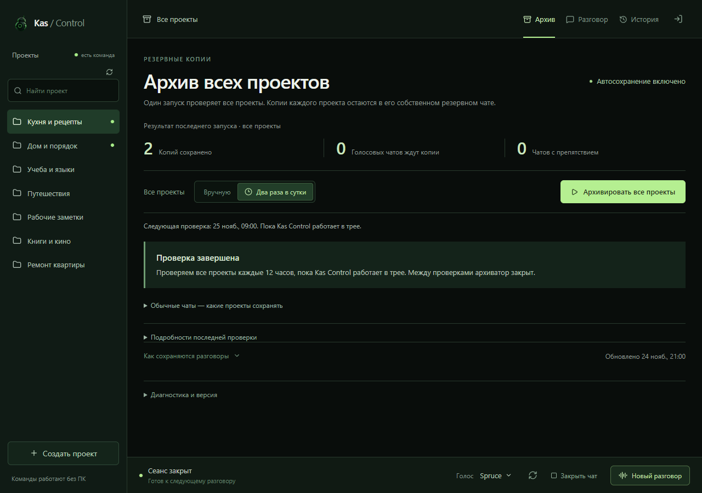

# Архив разговоров

**Архивировать все проекты** проверяет сохраненные голосовые сеансы и обычные чаты в проектах, где включено их копирование. Резерв каждого проекта находится в своем **Резервном голосовом чате** на ChatGPT.

## Что сохраняется

- **Голосовые чаты Каса.** Сохраняется доступный текст реплик пользователя и ChatGPT. Архиватор проверяет, что расшифровка перестала меняться, сверяет принадлежность обоих чатов проекту, читает записанную копию и повторно сравнивает исходник. Удаление исходника возможно после этих проверок, когда колонка свободна.
- **Обычные чаты.** Включите переключатели нужных проектов в **Обычные чаты — какие проекты сохранять**. При первом обходе сохраняется исходный текст, затем только новые сообщения и правки. Исходные чаты остаются в истории.
- **Вложения.** В проверенной копии вместо поддерживаемых изображений остаются текстовые метки. Сами изображения и аудиозаписи не входят в текстовый резерв. Остальные вложения, неизвестные типы данных и отсутствующая расшифровка могут оставить голосовой исходник на месте. Смотрите причину в подробностях.

В архиве можно найти сохраненный текст по дате и названию исходного разговора. Использование этих реплик в новых чатах зависит от настроек памяти ChatGPT. [Документация проектов](https://help.openai.com/en/articles/10169521-using-projects-in-chatgpt).

## Когда запускается

- **Вручную** — по кнопке **Архивировать все проекты**.
- **Два раза в сутки** — каждые 12 часов, пока Kas Control запущен в окне или трее. Пропущенные проверки сводятся к одной попытке.

Во время разговора обработка ждет свободной колонки. Голосовая очередь обрабатывается перед обходом обычных чатов. Во время копирования окно можно свернуть в трей. Отдельный процесс архиватора и его браузер завершаются по окончании обработки. Пункт **Выйти** в трее останавливает автоматические проверки и текущую обработку.

## Как читать результат

- **Кас сейчас разговаривает.** Завершите разговор, чтобы обработка продолжилась.
- **ChatGPT попросил сделать паузу.** Сервер ограничил частоту запросов. Архиватор соблюдает паузу. При завершенной попытке в ручном режиме повторите запуск после паузы. В автоматическом режиме продолжение возможно на следующей проверке.
- **Не все чаты удалось сохранить.** Откройте **Подробности последней проверки**. Там указаны проект, чат и причина. При неподтвержденной копии исходник остается.
- **Копий сохранено.** Показывает завершенные записи в архив. Число ожидающих голосовых чатов показывает очередь, а подробности содержат результат обработки отдельных чатов.

Для первой проверки возьмите короткий разговор в отдельном тестовом проекте и дождитесь его сохранения. Откройте резерв этого проекта и найдите обе реплики. Команда архивирования действует сразу на все настроенные проекты.
